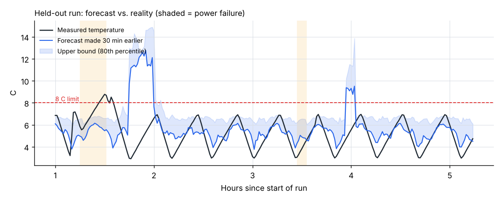
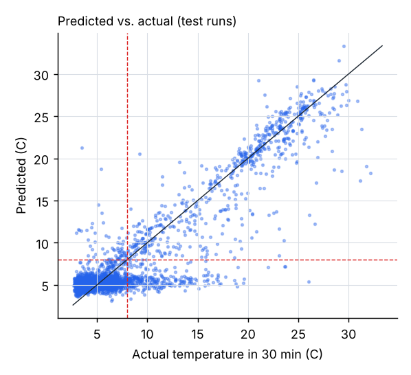
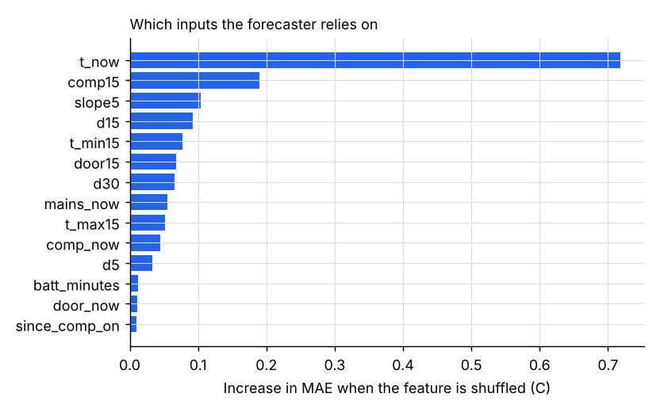
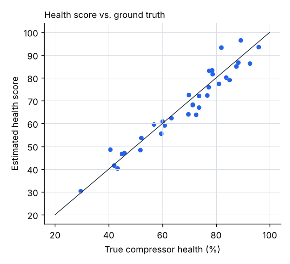

# ColdChain AI report

Trained 2026-11-01 18:30:24. All numbers below come from `ml/model/metrics.json`, produced by `python -m ml.train`.

## 1. Goal

1. Forecast each fridge's temperature **30 minutes ahead** and warn when it **may exceed 8 C**.
2. Score compressor health from 0 to 100 and flag weakening.
3. Feed both into relocation suggestions that a pharmacist confirms with one click.

## 2. Dataset

No dataset came with the brief, so training data is generated by a physics model of a vaccine fridge (`ml/physics.py`). Real readings recorded by the system can be added with `--db`.

| Item | Value |
| --- | --- |
| Runs | 160 (160 synthetic, 0 recorded) |
| Length of each synthetic run | 24.0 h at 5 s sampling |
| Training rows (1 per 2 min) | 88448 |
| Test rows | 22112 (20% of runs held out (no run in both sets)) |
| Test rows where T(+30 min) > 8 C | 28.7% |

Each run draws random room temperature (24-35 C), insulation, compressor strength, compressor wear and wear rate, door-opening habits and power failures. The fridge is controlled by the same rule as the firmware: ON at 7 C, OFF at 3 C, 60 s minimum off-time.

The model is: temperature change per minute = wall leak × (room − fridge) + door leak while open − compressor cooling × health.

**Limitation:** synthetic data teaches the model the physics but not the quirks of the actual fridges used at the demo. Retrain with `--db` after a few hours of real logging.

## 3. Features

Readings are resampled to 1-minute bins. Features describe the last 30 minutes. The same code (`backend/app/ai/features.py`) runs in training and in the live backend.

| Feature | Meaning |
| --- | --- |
| `t_now` | Mean temperature in the latest minute (C) |
| `d5` | Temperature change over the last 5 min |
| `d15` | Change over 15 min |
| `d30` | Change over 30 min |
| `slope5` | Least-squares slope over the last 6 min (C/min) |
| `t_max15` | Max temperature, last 15 min |
| `t_min15` | Min temperature, last 15 min |
| `comp_now` | Compressor ON fraction, latest minute |
| `comp15` | Compressor duty cycle, last 15 min |
| `door_now` | Door-open fraction, latest minute |
| `door15` | Door-open fraction, last 15 min |
| `mains_now` | 1 = mains power, 0 = battery |
| `batt_minutes` | Consecutive minutes on battery (cap 120) |
| `since_comp_on` | Minutes since the compressor last ran (cap 60) |

Target: temperature change over the next 30 minutes.

## 4. Models

- **Median forecaster:** gradient-boosted trees (`HistGradientBoostingRegressor`, absolute-error loss).
- **Upper-bound forecaster:** the same algorithm with a 0.8 quantile loss (80th percentile).
- **Warning rule:** warn when the upper bound is above 8 C. This matches the brief's "may go above 8 C". The quantile was chosen on held-out runs: 0.9 caught more breaches (recall 0.86) but half its warnings were false (precision 0.49); 0.8 balances the two.
- **Compressor health:** physics-based, no training needed. Capacity = warming rate with the compressor OFF − cooling rate with it ON, measured in clean minutes (door closed, 2-8.5 C). Health = capacity ÷ the capacity learned when the fridge was first calibrated.

## 5. Results (held-out test runs)

**Forecast error, temperature 30 min ahead (C)**

| Method | MAE | RMSE |
| --- | --- | --- |
| Gradient boosting (ours) | 1.694 | 2.659 |
| Persistence (no change) | 2.228 | 3.137 |
| Linear trend of last 5 min | 6.036 | 7.661 |

**Breach warning: "T(+30 min) > 8 C"**

| Method | Precision | Recall | F1 |
| --- | --- | --- | --- |
| Ours, upper bound (used live) | 0.723 | 0.781 | 0.75 |
| Ours, median forecast | 0.907 | 0.706 | 0.794 |
| Linear trend | 0.416 | 0.774 | 0.541 |

The upper bound was at or above the real value 77.6% of the time (target 80%). Warning on the upper bound instead of the median trades some precision for recall, which is the right trade for vaccines: a missed breach costs more than an extra check.

**Compressor health:** across 34 simulated fridges with known wear, the score was off by 3.68 points on average (correlation 0.964).

The forecaster relies most on `t_now`, `comp15`, `slope5`.

## 6. How it runs live

Every 30 s the backend:

1. Reads each fridge's last 6 h of readings.
2. Updates the forecast and health score.
3. Raises a *predicted breach* or *compressor weak* alert on change.
4. If a fridge may become unsafe, writes a relocation plan: least heat budget left goes first, and targets must be safe fridges with room.
5. The plan waits for a pharmacist's one-click confirmation.
